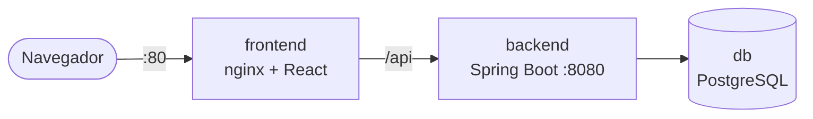

<div align="center">


**Homenagens de aniversário reunidas em um só lugar.**

Crie uma celebração, compartilhe o link com os convidados e entregue ao aniversariante um mural com todas as fotos e mensagens.


</div>

---

## 🎈 Sobre

Juntar homenagens para um aniversariante costuma ser bagunçado: as mensagens e fotos ficam espalhadas em conversas privadas, grupos e redes sociais. O **Celebrarte** centraliza tudo isso.

1. O **organizador** cria uma conta e cadastra a celebração com o nome do aniversariante e a data.
2. O sistema gera dois links exclusivos: um de **contribuição** e um do **mural**.
3. Os **convidados** abrem o link de contribuição e enviam foto, mensagem ou as duas, sem precisar criar conta.
4. O **aniversariante** e quem mais tiver o link do mural veem todas as homenagens reunidas.

O envio de homenagens fica aberto até dois dias depois da data do aniversário.

## ✨ Funcionalidades

- Cadastro, login e perfil de usuário com autenticação JWT
- Criação, edição e exclusão de celebrações
- Links exclusivos de contribuição e do mural, com QR Code para compartilhar
- Envio de homenagens com imagem e/ou mensagem, sem cadastro
- Mural público com as homenagens
- Painel do organizador para acompanhar e excluir homenagens

## 🧰 Tecnologias

| Camada | Stack |
| ------ | ----- |
| Frontend | React 19, React Router, Vite |
| Backend | Java 21, Spring Boot 4, Spring Security, Spring Data JPA |
| Banco de dados | PostgreSQL 17 |
| Infraestrutura | Docker Compose, nginx |

## 🐳 Rodando com Docker

Pré-requisito: Docker com o plugin Compose.

```bash
cp .env.example .env   # senha do banco e JWT_SECRET
docker compose up -d --build
```

O site fica em `http://localhost` (porta definida por `FRONTEND_PORT`). São três containers:

| Serviço | Imagem | Papel |
| ------- | ------ | ----- |
| `db` | `postgres:17-alpine` | Banco PostgreSQL, com os dados no volume `pgdata` |
| `backend` | `backend/Dockerfile` | API Spring Boot na porta 8080, acessível só pela rede interna |
| `frontend` | `frontend/Dockerfile` | nginx servindo o build do React e repassando `/api` ao backend |



Como o navegador fala só com o nginx, frontend e API ficam na mesma origem e não é preciso configurar CORS.

O backend só sobe depois que o banco responde (healthcheck com `pg_isready`) e se conecta a ele pelo nome `db`. As tabelas são criadas ou atualizadas pelo Hibernate ao iniciar a API.

### Acessando o banco

O banco também fica acessível na sua máquina em `localhost:5433` (porta definida por `POSTGRES_PORT`, aberta só para `127.0.0.1`), com o usuário e a senha do `.env`. Assim dá para abrir o banco no DBeaver/psql ou rodar a API fora do Docker com `SPRING_DATASOURCE_URL=jdbc:postgresql://localhost:5433/celebrarte`.

> [!NOTE]
> `POSTGRES_USER` e `POSTGRES_PASSWORD` só são aplicados quando o volume é criado. Para trocá-los depois, altere no banco (`ALTER USER ...`) ou apague os dados com `docker compose down -v`.

### Comandos úteis

```bash
docker compose logs -f backend   # logs da API
docker compose up -d --build     # recria as imagens depois de mudar o código
docker compose down              # para e remove os containers (os dados do banco continuam)
docker compose down -v           # remove também o volume: apaga todos os dados do banco
docker compose exec db psql -U celebrarte celebrarte   # console SQL
```

Para desenvolver sem Docker, veja [backend/README.md](backend/README.md) e [frontend/README.md](frontend/README.md).

## 📁 Estrutura do monorepo

```text
celebrarte/
├── assets/              # logo do projeto
├── docs/                # escopo, requisitos, regras de negócio, modelo de dados e arquitetura
├── frontend/            # aplicação React (Vite)
├── backend/             # API Spring Boot (Maven)
├── docker-compose.yml
└── .env.example
```
<!-- 
## 📚 Documentação

| Documento | Conteúdo |
| --------- | -------- |
| [Escopo](docs/01-escopo.md) | Problema, objetivos, público-alvo e funcionalidades |
| [Requisitos](docs/02-requisitos.md) | Requisitos funcionais e não funcionais |
| [Regras de negócio](docs/03-regras-de-negocio.md) | Regras que o sistema deve seguir |
| [Modelo de dados](docs/04-modelo-de-dados.drawio) | Diagrama das entidades (abra no draw.io) |
| [Arquitetura](docs/05-arquitetura.md) | Visão geral técnica do frontend, backend e infraestrutura |

## 👥 Autores

EDITAR PARA APARECER OS CARDS COM FOTO DE PERFIL:

- [Gabriel Tertuliano](https://github.com/CCodekey)
- [Hellen Lima](https://github.com/hellenilda) -->